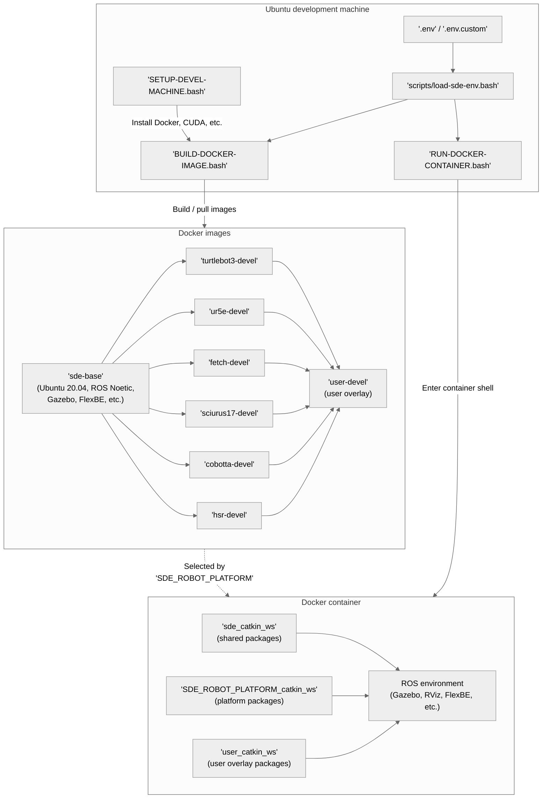

# Software Development Environment (SDE)

Open-source reference implementation of the Software Development Environment (SDE) described in "**Software Development Environment for Collaborative Research Workflow in Robotic System Integration**" (DOI: [10.1080/01691864.2022.2068353](https://doi.org/10.1080/01691864.2022.2068353)) and maintained by [Coarobo GK](https://coarobo.com/).

[](https://www.docker.com/)
[](http://wiki.ros.org/noetic)
[](https://releases.ubuntu.com/20.04/)
[](https://developer.nvidia.com/cuda-toolkit)
[](http://gazebosim.org/)
[](http://flexbe.github.io/)
[](https://docs.gitlab.com/ee/ci/)
[](https://git-scm.com/)
[](https://code.visualstudio.com/)
[](https://github.com/features/copilot)

[](LICENSE)

> [!TIP]
> Join the [SDE Community](https://coarobo.com/en/sde-community/) and help drive this open-source effort forward.
> For a production-ready solution with advanced features, explore [Coarobo](https://coarobo.com/).

## 📑 Content

[[_TOC_]]

## 🤖 Supported Robot Platforms

| Platform | Robot | Documentation |
| --- | --- | --- |
| `turtlebot3` | [Robotis TurtleBot3 (Waffle Pi)](https://emanual.robotis.com/docs/en/platform/turtlebot3/overview/) | [docs/robot-platforms/turtlebot3.md](docs/robot-platforms/turtlebot3.md) |
| `ur5e` | [Universal Robots UR5e](https://www.universal-robots.com/products/ur5e/) | [docs/robot-platforms/ur5e.md](docs/robot-platforms/ur5e.md) |
| `fetch` | [Fetch Robotics Fetch](https://fetchrobotics.github.io/docs/) | [docs/robot-platforms/fetch.md](docs/robot-platforms/fetch.md) |
| `sciurus17` | [RT Sciurus17](https://rt-net.jp/products/sciurus17/) | [docs/robot-platforms/sciurus17.md](docs/robot-platforms/sciurus17.md) |
| `cobotta` | [Denso COBOTTA](https://www.denso-wave.com/en/robot/product/collaborative/cobotta.html) | [docs/robot-platforms/cobotta.md](docs/robot-platforms/cobotta.md) |
| `hsr` | [Toyota HSR (Human Support Robot)](https://github.com/hsr-project) | [docs/robot-platforms/hsr.md](docs/robot-platforms/hsr.md) |

## 💻 Supported Software Platforms

| Platform | GPU Acceleration | Notes |
| --- | --- | --- |
| Ubuntu 24.04 LTS (native) | Nvidia GPU via [Nvidia Container Toolkit](https://docs.nvidia.com/datacenter/cloud-native/container-toolkit/latest/index.html) | Recommended setup |
| Ubuntu 24.04 LTS on Windows 11 via [WSL 2](https://learn.microsoft.com/en-us/windows/wsl/) | [WSLg](https://github.com/microsoft/wslg) D3D12 Mesa driver | Lower 3D performance than native |

## 🔍 Overview



## 🚀 Quick Start

> [!NOTE]
> The whole SDE is containerized/virtualized using [Docker](https://www.docker.com/).
> This ensures that all the contributors work in the exact same software environment.

1. Clone and set up:

    ```shell
    sudo apt-get update && sudo apt-get install -y git
    git clone https://gitlab.com/coarobo/SDE.git && cd SDE/
    bash ./SETUP-DEVEL-MACHINE.bash
    sudo reboot
    ```

2. Switch to the desired robot platform (default is `turtlebot3`):

    ```shell
    bash ./SWITCH-ROBOT-PLATFORM.bash turtlebot3
    ```

3. Build the Docker image:

    ```shell
    bash ./BUILD-DOCKER-IMAGE.bash
    ```

4. Run the Docker container:

    ```shell
    bash ./RUN-DOCKER-CONTAINER.bash
    ```

5. Inside the container, initialize the environment:

    ```shell
    sde-initialize-new-container
    ```

6. Exit the container (`Ctrl+d`) and launch the multi-terminal layout from the Ubuntu development machine:

    ```shell
    bash ./RUN-TERMINATOR-TERMINAL.bash
    ```

For detailed instructions, see the [Basic Usage](docs/basic-usage.md) guide.
For advanced features, see the [Advanced Usage](docs/advanced-usage.md) guide.

## 📁 Directory Structure

```
.env                                     # Default platform configuration.
env/
  turtlebot3.env                         # TurtleBot3 platform template.
  ur5e.env                               # UR5e platform template.
  fetch.env                              # Fetch platform template.
  sciurus17.env                          # Sciurus17 platform template.
  cobotta.env                            # COBOTTA platform template.
  hsr.env                                # HSR platform template.
  user.env                               # User overlay environment template (reference).
SETUP-DEVEL-MACHINE.bash                 # Host machine setup script.
BUILD-DOCKER-IMAGE.bash                  # Docker image build/pull script.
RUN-DOCKER-CONTAINER.bash                # Docker container run/enter script.
RUN-TERMINATOR-TERMINAL.bash             # Multi-terminal launcher script.
BRINGUP-ROS-ROBOT.bash                   # Robot bringup script.
RESTART-CHRONY-SERVICE.bash              # Host and robot clock sync script.
SWITCH-ROBOT-PLATFORM.bash               # Platform switching script.
scripts/
  load-sde-env.bash                      # Shared environment loader.
docker/
  docker-compose.yaml                    # Docker service definitions.
  docker-compose-turtlebot3.yaml         # TurtleBot3 platform overlay.
  docker-compose-ur5e.yaml               # UR5e platform overlay.
  docker-compose-fetch.yaml              # Fetch platform overlay.
  docker-compose-sciurus17.yaml          # Sciurus17 platform overlay.
  docker-compose-cobotta.yaml            # COBOTTA platform overlay.
  docker-compose-hsr.yaml                # HSR platform overlay.
  docker-compose-user.yaml               # User overlay (always loaded).
  docker-compose-nvidia.yaml             # GPU overlay for Nvidia support.
  docker-compose-wsl.yaml                # GPU overlay for WSL 2 support.
  sde-base/                              # Shared base Docker image.
    Dockerfile
    scripts/                             # Container helper scripts.
  turtlebot3-devel/                      # TurtleBot3 platform image.
    Dockerfile
  ur5e-devel/                            # UR5e platform image.
    Dockerfile
  fetch-devel/                           # Fetch platform image.
    Dockerfile
  sciurus17-devel/                       # Sciurus17 platform image.
    Dockerfile
  cobotta-devel/                         # COBOTTA platform image.
    Dockerfile
  hsr-devel/                             # HSR platform image.
    Dockerfile
  user-devel/                            # User overlay image (Layer 3, runtime container).
    Dockerfile
ros/
  sde_catkin_ws/                         # Shared Catkin workspace.
  turtlebot3_catkin_ws/                  # TurtleBot3 Catkin workspace.
  ur5e_catkin_ws/                        # UR5e Catkin workspace.
  fetch_catkin_ws/                       # Fetch Catkin workspace.
  sciurus17_catkin_ws/                   # Sciurus17 Catkin workspace.
  cobotta_catkin_ws/                     # COBOTTA Catkin workspace.
  hsr_catkin_ws/                         # HSR Catkin workspace.
  user_catkin_ws/                        # User overlay Catkin workspace (sde_user_launch, sde_user_behaviors).
docs/                                    # Documentation.
  basic-usage.md
  advanced-usage.md
  robot-platforms/
    turtlebot3.md
    ur5e.md
    fetch.md
    sciurus17.md
    cobotta.md
    hsr.md
terminator/
  turtlebot3.config                      # TurtleBot3 Terminator layout.
  ur5e.config                            # UR5e Terminator layout.
  fetch.config                           # Fetch Terminator layout.
  sciurus17.config                       # Sciurus17 Terminator layout.
  cobotta.config                         # COBOTTA Terminator layout.
  hsr.config                             # HSR Terminator layout.
patches/                                 # Submodule patch files.
gitlab-ci/                               # GitLab CI/CD scripts.
```

## 📖 Documentation

| Document | Description |
| --- | --- |
| [Basic Usage](docs/basic-usage.md) | Full setup guide: prerequisites, installation, build, and run |
| [Advanced Usage](docs/advanced-usage.md) | Bash functions, multiple terminals, Docker configuration, environment variables |
| [Robot Platforms / TurtleBot3](docs/robot-platforms/turtlebot3.md) | Robotis TurtleBot3 robot configuration, installation, and operation |
| [Robot Platforms / UR5e](docs/robot-platforms/ur5e.md) | Universal Robots UR5e setup, network, ROS communication, and operation |
| [Robot Platforms / Fetch](docs/robot-platforms/fetch.md) | Fetch Robotics Fetch robot configuration, installation, and operation |
| [Robot Platforms / Sciurus17](docs/robot-platforms/sciurus17.md) | RT Sciurus17 robot configuration, installation, and operation |
| [Robot Platforms / COBOTTA](docs/robot-platforms/cobotta.md) | Denso COBOTTA robot configuration, installation, and operation |
| [Robot Platforms / HSR](docs/robot-platforms/hsr.md) | Toyota HSR (Human Support Robot) simulation-only configuration, installation, and operation |
| [User Overlay](docs/user-overlay.md) | Add your own ROS packages, Docker layer, env vars, and Terminator panes without forking the SDE |

## 📄 Related Publications

Summaries of the development history, requirements, vision, and goals of the SDE have been published in the following papers:
- International journals:
  - L. El Hafi, G. A. Garcia Ricardez, F. von Drigalski, Y. Inoue, M. Yamamoto, and T. Yamamoto, "**Software Development Environment for Collaborative Research Workflow in Robotic System Integration**", in *RSJ Advanced Robotics (AR), Special Issue on Software Framework for Robot System Integration*, vol. 36, no. 11, pp. 533-547, Jun. 3, 2022. DOI: [10.1080/01691864.2022.2068353](https://doi.org/10.1080/01691864.2022.2068353)
- Domestic conferences:
  - L. El Hafi and T. Yamamoto, "**Toward the Public Release of a Software Development Environment for Human Support Robots**", in *Proceedings of 2020 Annual Conference of the Robotics Society of Japan (RSJ 2020)*, ref. RSJ2020AC3E1-01, pp. 1-2, (Virtual), Oct. 9, 2020.
  - L. El Hafi, S. Matsuzaki, S. Itadera, and T. Yamamoto, "**Deployment of a Containerized Software Development Environment for Human Support Robots**", in *Proceedings of 2019 Annual Conference of the Robotics Society of Japan (RSJ 2019)*, ref. RSJ2019AC3K1-03, pp. 1-2, Tokyo, Japan, Sep. 3, 2019.
  - L. El Hafi, Y. Hagiwara, and T. Taniguchi, "**Abstraction-Rich Workflow for Agile Collaborative Development and Deployment of Robotic Solutions**", in *Proceedings of 2018 Annual Conference of the Robotics Society of Japan (RSJ 2018)*, ref. RSJ2018AC3D3-02, pp. 1-3, Kasugai, Japan, Sep. 5, 2018.

> [!NOTE]
> Cite these papers if you are using the SDE to implement your research!
> It is crucially important to disseminate the SDE across the robotics research community.

## 🔗 External Resources

- Coarobo GK:
  - Official website: [https://coarobo.com/](https://coarobo.com/)
  - GitLab group: [https://gitlab.com/coarobo](https://gitlab.com/coarobo)
  - GitHub organization: [https://github.com/coarobo](https://github.com/coarobo)

## 🐛 Reporting Issues

Please report any issue or future work using the GitLab issue tracker: [https://gitlab.com/coarobo/SDE/issues](https://gitlab.com/coarobo/SDE/issues).

## 🤝 Contributing

- This repository uses explicit commit messages following the [Conventional Commits](https://www.conventionalcommits.org/en/v1.0.0/) specification.
- This project follows [Semantic Versioning](https://semver.org/) for releases.
- This project follows the [Make a README](https://www.makeareadme.com/) guidelines for documentation structure.
- This project relies on [`AGENTS.md`](AGENTS.md) for coding conventions and instructions provided to AI agents.

See [`CONTRIBUTING.md`](CONTRIBUTING.md) for detailed contribution guidelines, including a step-by-step guide for adding support for a new robot platform.

## 👥 Authors & Acknowledgment

### 🔧 Maintainers

- **Lotfi El Hafi** (lotfi@coarobo.com)
- Sebastian Carrera (sebastian@coarobo.com)

### ✍️ Authors

- **Lotfi El Hafi**
- Felix von Drigalski
- Gustavo Alfonso Garcia Ricardez
- Masaki Yamamoto
- Shigemichi Matsuzaki
- Shunki Itadera
- Tadahiro Taniguchi
- Takashi Yamamoto
- Yoshinobu Hagiwara
- Yuki Inoue

### 🙏 Contributors

- Hiroyuki Okada
- Kazuki Miyzawa
- Keisuke Takeshita
- Kensuke Iwata
- Luis Contreras
- Nobuyuki Matsuno
- Takato Horii
- Tatsuya Matsushima
- Tomohiro Ono
- Yaonan Zhu
- Yoshiaki Asahara

## ⚖️ License

```
MIT License

Copyright (c) 2019 Coarobo GK
```

See [`LICENSE`](LICENSE) for details.

## 📜 Third-Party Software

The SDE Docker images bundle third-party robotics middleware, drivers, and simulation assets, each governed by its own license.
Notable platform-specific bundling:

| Platform | Component | License |
| --- | --- | --- |
| HSR | [`ghcr.io/hsr-project/tmc_wrs_binary`](https://github.com/hsr-project/tmc_wrs_docker) (full HSR ROS Noetic stack, WRS apartment world) | [BSD 3-Clause Clear](https://spdx.org/licenses/BSD-3-Clause-Clear.html) (Toyota Motor Corporation) |
| All | [ROS Noetic](https://www.ros.org/), [Gazebo](http://gazebosim.org/), [FlexBE](http://flexbe.github.io/), and platform-specific upstream packages | Per upstream (BSD, Apache 2.0, MIT, etc.) |

See each `docs/robot-platforms/<platform>.md` document for platform-specific licensing details.
